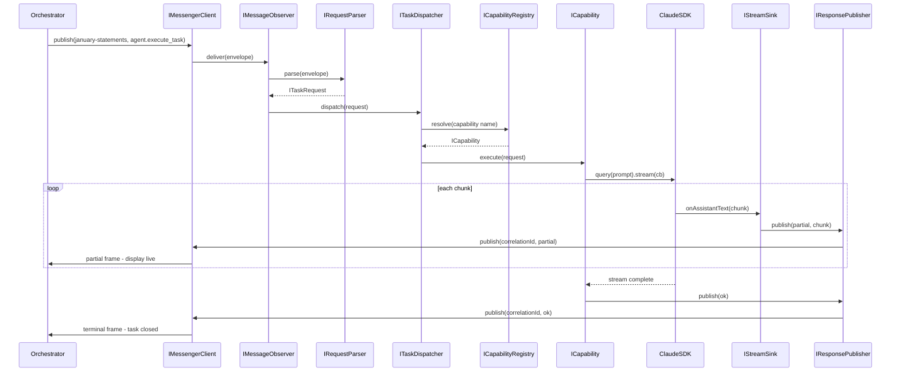

# Jeri (TypeScript Edition) — Financial Expert Agent Blueprint

> Companion / replacement for `jerri_blueprint.md`. Same agent concept, same A2A
> routing contract, but the **execution layer is rewritten in TypeScript** and
> uses the **locally-built `claude-code-sdk-ts` fluent API** (`claude()` /
> `QueryBuilder` / `ResponseParser`) to spawn Claude work — **no Codex CLI**.

---

## 0. Build & Run — Local SDK Setup

Jeri uses the SDK from this repository directly, not the published npm package.
`jeri_agent/package.json` declares the dependency as a `file:` path:

```json
{
  "dependencies": {
    "@instantlyeasy/claude-code-sdk-ts": "file:.."
  }
}
```

This keeps all import statements inside Jeri identical to what they would be
against the published package (`import { claude } from '@instantlyeasy/claude-code-sdk-ts'`),
so switching to the npm release later is a one-line change in `package.json`.

### First-time setup

```bash
# 1. Build the SDK (from the repo root — do this whenever you change SDK code)
cd /home/adamsl/claude-code-sdk-ts
npm install
npm run build          # outputs CJS + ESM to dist/

# 2. Install Jeri's dependencies (file: symlink picks up the local build)
cd jeri_agent
npm install

# 3. Build Jeri itself
npm run build          # jeri_agent uses tsup too
```

### Running during development

```bash
# From jeri_agent/
npx tsx src/index.ts   # hot-reload friendly, uses the local SDK src via file:
```

### Rebuilding after SDK changes

```bash
# In one terminal (SDK repo root):
npm run dev            # watch mode — rebuilds dist/ on every save

# In another terminal (jeri_agent/):
npx tsx src/index.ts   # automatically sees the updated dist/ via file:
```

### `jeri_agent/tsconfig.json` note

Set `"paths"` so the IDE resolves the local source for navigation:

```json
{
  "compilerOptions": {
    "paths": {
      "@instantlyeasy/claude-code-sdk-ts": ["../src/index.ts"]
    }
  }
}
```

This is IDE-only — the runtime still resolves through `node_modules/` and the
`file:..` symlink, so build output is always from the compiled `dist/`.

---

## 1. Goal

Build a financial-domain specialist agent ("Jeri") that:

1. Plugs into the existing orchestrator-agent A2A WebSocket mesh exactly the
   way the Coder Agent does — discoverable via `agent.json`, subscribes to a
   primary topic, responds to JSON-RPC `agent.execute_task` payloads.
2. Performs its actual *work* (analysis, extraction, summarization, anomaly
   detection on bank-statement and other financial documents) by composing
   Claude calls through this repo's fluent API rather than shelling out to
   Codex CLI.
3. Is built **to interfaces, not implementations** — every collaborator (Claude
   client, messenger, document store, scope guard, retry strategy, logger, ...)
   is injected so we can stub it in tests and swap implementations later.

The fluent SDK is the *only* way Jeri talks to Claude. All Codex CLI references
in the original Python blueprint are removed.

---

## 2. Agent Identity + Routing Contract

Identical to the Python blueprint so routing is predictable:

```
AGENT_NAME           = "jeri-agent"
AGENT_PRIMARY_TOPIC  = "january-statements"
AGENT_OTHER_TOPICS   = ["bank-statements", "readable-documents",
                        "document-analysis"]
TARGET_DIR           = "/home/adamsl/rol_finances/readable_documents/bank_statements/january"
```

Why preserved verbatim:

- The orchestrator discovers agents from `agent.json` files.
- The first topic in the card drives `A2ACollectiveHub.prepare_delegation()`.
- Changing identity or topic ordering would force orchestrator-side changes we
  do not want to make right now.

---

## 3. Files to Add

```
jeri_agent/
  agent.json                       # Coder-style card (unchanged shape)
  package.json
  tsconfig.json
  src/
    index.ts                       # Process entry — wires container, starts agent
    container.ts                   # Composition root (DI wiring)
    interfaces/                    # All GoF interfaces (stubs only for now)
      a2a.ts
      capabilities.ts
      claude.ts
      documents.ts
      lifecycle.ts
      policy.ts
      session.ts
      telemetry.ts
    capabilities/                  # One file per capability (Command pattern)
      analyze-statement.ts
      extract-transactions.ts
      summarize-statement.ts
      prepare-report-snippet.ts
      find-anomalies.ts
    adapters/                      # Concrete adapters (later — interfaces first)
    domain/                        # Pure financial domain types
  start_jeri_agent.sh
  stop_jeri_agent.sh
  logs/                            # gitkeep
```

We deliberately do **not** drop adapter code yet — the Team reviews the
interface set first, then we implement.

---

## 4. `jeri_agent/agent.json` (Coder-style card)

Shape unchanged from the Python blueprint; only the runtime it points at
differs.

Required top-level fields:

- `name`: `"jeri-agent"`
- `version`: `"1.0.0"`
- `description`: financial-document specialist (January bank statements first)
- `capabilities`: array of callable tasks with input/output schema
- `topics`: `["january-statements", "bank-statements", "readable-documents",
            "document-analysis"]`
- `memory_access`: `"read-write"`
- `runtime`: `"node"`  *(new — lets orchestrator log which runtime it spawned)*

Suggested capabilities (each maps to one `ICapability` implementation):

- `analyze_statement`
- `extract_transactions`
- `summarize_statement`
- `prepare_report_snippet`
- `find_anomalies`

Each capability input schema must accept at minimum:

- `description: string`
- `context?: Record<string, unknown>` *(optional)*

---

## 5. Architectural Overview (GoF Lens)

| Layer                       | GoF Pattern                | What It Does                                                                       |
| --------------------------- | -------------------------- | ---------------------------------------------------------------------------------- |
| `FinancialAgent` (entry)    | **Facade**                 | One coarse method (`handleTask`) the messenger calls; hides everything below.      |
| `CapabilityRegistry`        | **Registry + Strategy**    | Looks up the right `ICapability` for an incoming task name.                        |
| `ICapability`               | **Command**                | Encapsulates one task ("extract transactions") as an executable object.            |
| `IClaudeQueryFactory`       | **Abstract Factory**       | Produces fresh `IQueryBuilder` instances pre-configured with policies.             |
| `IQueryBuilder` (our port)  | **Builder**                | Wraps the SDK's `QueryBuilder` behind our own interface so we can mock it.         |
| `IResponseParser` (our port)| **Builder result**         | Wraps the SDK's `ResponseParser`.                                                  |
| `IMessengerClient`          | **Adapter**                | Adapts the existing Python AgentMessenger protocol to a TS client we control.      |
| `IMessageObserver`          | **Observer**               | Topic subscribers — `onMessage` callbacks.                                         |
| `IScopeGuard` / `IPathPolicy`| **Strategy**              | Enforces "no file access outside `TARGET_DIR`" (and overrides).                    |
| `IToolPolicy`               | **Strategy**               | Decides allow/deny tool sets per capability.                                       |
| `IRetryStrategy`            | **Strategy**               | Pluggable retry/backoff (exponential, linear, fibonacci — already in SDK).         |
| `IPromptTemplate`           | **Template Method**        | Skeleton prompt with hook methods filled by each capability.                       |
| `ISessionStore`             | **Memento**                | Holds Claude session IDs so multi-turn capabilities keep context.                  |
| `IArtifactStore`            | **Repository**             | Persists generated summaries / report snippets and returns reference handles.      |
| `IDocumentRepository`       | **Repository**             | Read-side access to statement files under `TARGET_DIR`.                            |
| `MultiLogger` (SDK)         | **Composite**              | Already a composite — we just wire it.                                             |
| `withRetry` / `withTelemetry`| **Decorator**             | Wrap `ICapability` instances with cross-cutting concerns.                          |
| `IErrorClassifier`          | **Chain of Responsibility**| Walks classifiers (network / auth / scope / parse) to pick a recovery strategy.    |
| `IContainer`                | **Service Locator / DI**   | Composition root — built in `container.ts`, never referenced from domain code.     |

The **boundary between Jeri and the SDK is one interface family**
(`IClaudeQueryFactory` → `IQueryBuilder` → `IResponseParser`). Inside the
adapter we call `claude().withModel(...).allowTools(...).query(prompt).asText()`.
Everywhere else in Jeri we only see *our* interfaces.

---

## 6. Interface Stubs

All stubs live under `jeri_agent/src/interfaces/`. They are intentionally
implementation-free — the Team approves the surface before any adapter is
written.

### 6.1 `interfaces/claude.ts` — SDK boundary

```ts
// Resolves to the local build via "file:.." in jeri_agent/package.json.
// To publish against the npm release, change package.json only — no code change.
import type { Logger, LogEntry, LogLevel } from '@instantlyeasy/claude-code-sdk-ts';

/** Identifies which Claude model a capability wants. */
export type ClaudeModel = 'opus' | 'sonnet';

/** Allow/deny tool list, expressed as the SDK's ToolName strings. */
export interface IToolPolicy {
  allow(): readonly string[];
  deny(): readonly string[];
  /** If true, capability runs in pure read-only mode (no tools at all). */
  readOnly(): boolean;
}

/** Permission posture for a capability. */
export interface IPermissionStrategy {
  skipPermissions(): boolean;
  acceptEdits(): boolean;
  mode(): 'default' | 'skip' | 'accept-edits';
}

/** Working-directory policy — see also IScopeGuard. */
export interface IWorkspacePolicy {
  primaryDir(): string;
  additionalDirs(): readonly string[];
  env(): Readonly<Record<string, string>>;
}

/** Cancellation handle. Wraps AbortSignal so domain code never sees Node API. */
export interface ICancellationToken {
  readonly signal: AbortSignal;
  cancel(reason?: string): void;
  isCancelled(): boolean;
}

/** Our port over the SDK's QueryBuilder. */
export interface IQueryBuilder {
  withModel(model: ClaudeModel): this;
  withTimeoutMs(ms: number): this;
  withToolPolicy(policy: IToolPolicy): this;
  withPermissionStrategy(strategy: IPermissionStrategy): this;
  withWorkspace(policy: IWorkspacePolicy): this;
  withSessionId(id: string): this;
  withCancellation(token: ICancellationToken): this;
  withLogger(logger: Logger): this;
  withRole(name: string, vars?: Record<string, string>): this;
  withConfigFile(path: string): this;
  onMessage(cb: (m: unknown) => void): this;
  onAssistant(cb: (m: unknown) => void): this;
  onToolUse(cb: (t: unknown) => void): this;
  onError(cb: (e: Error) => void): this;
  query(prompt: string): IResponseParser;
}

/** Our port over the SDK's ResponseParser. */
export interface IResponseParser {
  asText(): Promise<string>;
  asJSON<T = unknown>(): Promise<T>;
  asResult(): Promise<unknown>;
  asArray(): Promise<readonly unknown[]>;
  asToolExecutions(): Promise<readonly IToolExecution[]>;
  findToolResults(toolName: string): Promise<readonly unknown[]>;
  findToolResult(toolName: string): Promise<unknown | undefined>;
  getUsage(): Promise<IUsageReport>;
  getSessionId(): Promise<string | undefined>;
  succeeded(): Promise<boolean>;
  stream(sink: IStreamSink): Promise<void>;
}

/** Abstract Factory — yields a fresh, policy-pre-configured builder. */
export interface IClaudeQueryFactory {
  newBuilder(opts?: {
    model?: ClaudeModel;
    tools?: IToolPolicy;
    permissions?: IPermissionStrategy;
    workspace?: IWorkspacePolicy;
    sessionId?: string;
    cancellation?: ICancellationToken;
  }): IQueryBuilder;
}

/** Observer for streamed messages (wraps the SDK's stream() callback). */
export interface IStreamSink {
  onAssistantText(text: string): Promise<void> | void;
  onToolUse(toolName: string, input: unknown): Promise<void> | void;
  onDone(): Promise<void> | void;
  onError(err: Error): Promise<void> | void;
}

/** Subset of SDK tool-execution result we expose to domain code. */
export interface IToolExecution {
  readonly tool: string;
  readonly input: unknown;
  readonly output: unknown;
  readonly isError: boolean;
}

/** Usage report value object. */
export interface IUsageReport {
  readonly inputTokens: number;
  readonly outputTokens: number;
  readonly totalTokens: number;
  readonly totalCostUsd: number;
}

/** Factory for SDK loggers, so we can swap Console/JSON/Multi/Null at the edge. */
export interface ILoggerFactory {
  create(level: LogLevel, prefix?: string): Logger;
  fanOut(loggers: readonly Logger[]): Logger;
}

export type { Logger, LogEntry, LogLevel };
```

### 6.2 `interfaces/capabilities.ts` — Command pattern

```ts
import type { ICancellationToken, IResponseParser, IUsageReport } from './claude.js';
import type { IArtifactRef } from './documents.js';

/** Input envelope from A2A JSON-RPC `agent.execute_task`. */
export interface ITaskRequest {
  readonly capability: string;        // e.g. "extract_transactions"
  readonly description: string;
  readonly context?: Readonly<Record<string, unknown>>;
  readonly correlationId: string;     // for telemetry / log stitching
  readonly cancellation: ICancellationToken;
}

/** Response envelope sent back to the orchestrator. */
export interface ITaskResponse {
  readonly status: 'ok' | 'error' | 'partial';
  readonly message: string;
  readonly details?: Readonly<Record<string, unknown>>;
  readonly artifacts?: readonly IArtifactRef[];
  readonly usage?: IUsageReport;
}

/** One Command. Each capability gets its own class implementing this. */
export interface ICapability {
  readonly name: string;
  /** Optional JSON-Schema describing input.context for documentation only. */
  inputSchema?(): Readonly<Record<string, unknown>>;
  canHandle(request: ITaskRequest): boolean;
  execute(request: ITaskRequest): Promise<ITaskResponse>;
}

/** Registry + lookup. */
export interface ICapabilityRegistry {
  register(capability: ICapability): void;
  resolve(name: string): ICapability | undefined;
  list(): readonly ICapability[];
}

/** Decorator hook — wrap a capability with retry, telemetry, scope, etc. */
export interface ICapabilityDecorator {
  decorate(inner: ICapability): ICapability;
}

/** Template Method for prompts. */
export interface IPromptTemplate {
  readonly id: string;
  /** Final composed prompt string. */
  render(vars: Readonly<Record<string, unknown>>): string;
}

export interface IPromptComposer {
  compose(template: IPromptTemplate, request: ITaskRequest): string;
}

/** Domain-facing result transform — maps a parser result into a TaskResponse. */
export interface IResponseFormatter<T = unknown> {
  format(parser: IResponseParser): Promise<{ payload: T; response: ITaskResponse }>;
}
```

### 6.3 `interfaces/a2a.ts` — Messenger / orchestrator boundary

```ts
import type { ITaskRequest, ITaskResponse } from './capabilities.js';

export interface IAgentIdentity {
  readonly name: string;             // "jeri-agent"
  readonly version: string;
  readonly primaryTopic: string;     // "january-statements"
  readonly topics: readonly string[];
}

/** What the orchestrator reads from `agent.json`. */
export interface IAgentCard {
  identity(): IAgentIdentity;
  capabilities(): readonly { name: string; description?: string }[];
  memoryAccess(): 'none' | 'read-only' | 'read-write';
  runtime(): 'node' | 'python';
  toJSON(): Record<string, unknown>;
}

/** Pub/sub subscription handle. */
export interface ITopicSubscription {
  readonly topic: string;
  unsubscribe(): Promise<void>;
}

/** Observer for inbound A2A messages. */
export interface IMessageObserver {
  onMessage(envelope: IInboundEnvelope): Promise<void>;
}

/** Raw A2A envelope as delivered by the messenger. */
export interface IInboundEnvelope {
  readonly topic: string;
  readonly from: string;
  readonly correlationId: string;
  readonly kind: 'jsonrpc' | 'text';
  readonly payload: unknown;
}

/** Adapter over the existing WebSocket AgentMessenger. */
export interface IMessengerClient {
  connect(): Promise<void>;
  subscribe(topic: string, observer: IMessageObserver): Promise<ITopicSubscription>;
  publish(topic: string, payload: unknown, correlationId?: string): Promise<void>;
  close(): Promise<void>;
}

/** Maps inbound envelopes to a normalized TaskRequest. */
export interface IRequestParser {
  parse(envelope: IInboundEnvelope): ITaskRequest;
}

/** Serializes a TaskResponse back onto the wire. */
export interface IResponsePublisher {
  publish(replyTo: IInboundEnvelope, response: ITaskResponse): Promise<void>;
}

/** Mediator — owns the request → capability → response cycle. */
export interface ITaskDispatcher {
  dispatch(request: ITaskRequest): Promise<ITaskResponse>;
}
```

### 6.4 `interfaces/documents.ts` — Financial-domain Repository layer

```ts
/** A file under the target directory (or an explicitly allowed override). */
export interface IDocumentRef {
  readonly path: string;
  readonly bytes: number;
  readonly modifiedAt: Date;
  readonly mimeType?: string;
}

/** Lightweight artifact handle returned in TaskResponse.artifacts. */
export interface IArtifactRef {
  readonly id: string;
  readonly path: string;
  readonly kind: 'summary' | 'report-snippet' | 'transactions-csv' | 'anomaly-report';
  readonly createdAt: Date;
}

export interface IDocumentRepository {
  list(): Promise<readonly IDocumentRef[]>;
  find(predicate: (d: IDocumentRef) => boolean): Promise<readonly IDocumentRef[]>;
  open(ref: IDocumentRef): Promise<IDocumentHandle>;
}

export interface IDocumentHandle {
  readonly ref: IDocumentRef;
  readText(): Promise<string>;
  close(): Promise<void>;
}

export interface IDocumentParser {
  parse(handle: IDocumentHandle): Promise<IParsedStatement>;
}

/** Pure value object — no Claude in here. */
export interface IParsedStatement {
  readonly accountId?: string;
  readonly periodStart?: Date;
  readonly periodEnd?: Date;
  readonly openingBalance?: number;
  readonly closingBalance?: number;
  readonly transactions: readonly ITransaction[];
  readonly unparsedRegions: readonly string[];
}

export interface ITransaction {
  readonly date: Date;
  readonly description: string;
  readonly amount: number;             // signed
  readonly balanceAfter?: number;
  readonly category?: string;
}

export interface ITransactionExtractor {
  extract(handle: IDocumentHandle): Promise<readonly ITransaction[]>;
}

export interface IStatementSummarizer {
  summarize(parsed: IParsedStatement): Promise<string>;
}

export interface IAnomalyDetector {
  detect(parsed: IParsedStatement): Promise<readonly IAnomaly[]>;
}

export interface IAnomaly {
  readonly kind: 'duplicate' | 'large-debit' | 'category-drift' | 'unparseable' | 'other';
  readonly evidence: string;
  readonly transaction?: ITransaction;
  readonly severity: 'info' | 'warn' | 'error';
}

export interface IReportSnippetBuilder {
  build(parsed: IParsedStatement, anomalies: readonly IAnomaly[]): Promise<string>;
}

/** Write-side for any generated outputs. */
export interface IArtifactStore {
  put(kind: IArtifactRef['kind'], content: string | Uint8Array): Promise<IArtifactRef>;
  get(id: string): Promise<{ ref: IArtifactRef; content: Uint8Array }>;
}
```

### 6.5 `interfaces/policy.ts` — Cross-cutting strategies

```ts
import type { IDocumentRef } from './documents.js';
import type { ICapability } from './capabilities.js';

/** Decides whether a path is in-scope for Jeri. */
export interface IPathPolicy {
  isAllowed(absPath: string): boolean;
  explain(absPath: string): string;     // human-readable rejection reason
}

/** Hard scope guard — wraps repository / file ops. */
export interface IScopeGuard {
  ensureInScope(ref: IDocumentRef): void;          // throws if not
  ensurePathInScope(absPath: string): void;        // throws if not
  withOverride(allowed: readonly string[]): IScopeGuard;
}

/** Retry strategy abstraction (the SDK ships exponential/linear/fibonacci). */
export interface IRetryStrategy {
  readonly name: 'exponential' | 'linear' | 'fibonacci' | 'fixed';
  nextDelayMs(attempt: number): number;
  shouldRetry(error: unknown, attempt: number): boolean;
}

export interface IRetryPolicy {
  readonly maxAttempts: number;
  readonly strategy: IRetryStrategy;
}

export interface ICircuitBreaker {
  allow(): boolean;
  recordSuccess(): void;
  recordFailure(err: unknown): void;
  state(): 'closed' | 'open' | 'half-open';
}

/** Chain of Responsibility over error classification. */
export interface IErrorClassifier {
  classify(err: unknown): IClassifiedError | undefined;
  next?: IErrorClassifier;
}

export interface IClassifiedError {
  readonly category:
    | 'network'
    | 'authentication'
    | 'permission'
    | 'timeout'
    | 'validation'
    | 'cli'
    | 'configuration'
    | 'scope'
    | 'parse'
    | 'unknown';
  readonly retryable: boolean;
  readonly resolution?: string;
  readonly original: unknown;
}

export interface IErrorRecoveryStrategy {
  recover(err: IClassifiedError): Promise<'retry' | 'fail' | 'fallback'>;
}

/** Decorator that wraps any capability with retry + telemetry + scope checks. */
export interface ICapabilityWrapper {
  withRetry(policy: IRetryPolicy): ICapabilityWrapper;
  withTelemetry(): ICapabilityWrapper;
  withScope(guard: IScopeGuard): ICapabilityWrapper;
  withCircuitBreaker(cb: ICircuitBreaker): ICapabilityWrapper;
  build(inner: ICapability): ICapability;
}
```

### 6.6 `interfaces/session.ts` — Memento-style session continuity

```ts
export interface ISessionId {
  readonly value: string;
  readonly issuedAt: Date;
}

export interface ISessionStore {
  get(key: string): Promise<ISessionId | undefined>;
  put(key: string, id: ISessionId): Promise<void>;
  drop(key: string): Promise<void>;
}

/** Builds a stable cache key for "give me the session for this correlation". */
export interface ISessionKeyStrategy {
  keyFor(correlationId: string, capability: string): string;
}

export interface ISessionFactory {
  open(key: string): Promise<ISessionId>;       // creates if missing
  resume(key: string): Promise<ISessionId | undefined>;
}
```

### 6.7 `interfaces/telemetry.ts` — Observability hooks

```ts
import type { IUsageReport } from './claude.js';

export interface ITelemetryEvent {
  readonly name: string;
  readonly timestamp: Date;
  readonly correlationId?: string;
  readonly attributes: Readonly<Record<string, unknown>>;
}

export interface ITelemetrySink {
  emit(event: ITelemetryEvent): void;
}

export interface IUsageReporter {
  report(capability: string, usage: IUsageReport, correlationId: string): void;
}

export interface IMetricsCollector {
  counter(name: string, value?: number, tags?: Record<string, string>): void;
  histogram(name: string, value: number, tags?: Record<string, string>): void;
  gauge(name: string, value: number, tags?: Record<string, string>): void;
}

export interface IClock {
  now(): Date;
  monotonicMs(): number;
}
```

### 6.8 `interfaces/lifecycle.ts` — Process / DI

```ts
import type { IMessengerClient, IAgentCard } from './a2a.js';
import type { ICapabilityRegistry } from './capabilities.js';

/** Composition root surface. Implementations live in container.ts. */
export interface IContainer {
  resolve<T>(token: symbol): T;
  register<T>(token: symbol, factory: (c: IContainer) => T): void;
}

/** Owns process start / stop, signal handling, PID file. */
export interface IProcessLifecycle {
  start(): Promise<void>;
  stop(reason?: string): Promise<void>;
  onShutdown(cb: () => Promise<void> | void): void;
}

export interface IPidFile {
  readonly path: string;
  write(pid: number): Promise<void>;
  read(): Promise<number | undefined>;
  remove(): Promise<void>;
}

export interface IHealthCheck {
  ping(): Promise<{ ok: boolean; details?: Record<string, unknown> }>;
}

/** Top-level Facade — the *only* thing index.ts wires up. */
export interface IFinancialAgent {
  readonly card: IAgentCard;
  start(): Promise<void>;
  stop(reason?: string): Promise<void>;
}

/** Used by container.ts to publish DI tokens without circular imports. */
export interface ITokens {
  readonly Container: symbol;
  readonly Agent: symbol;
  readonly Messenger: symbol;
  readonly Registry: symbol;
  readonly ClaudeFactory: symbol;
  readonly DocumentRepository: symbol;
  readonly ArtifactStore: symbol;
  readonly ScopeGuard: symbol;
  readonly LoggerFactory: symbol;
  readonly Clock: symbol;
  readonly SessionStore: symbol;
  readonly Telemetry: symbol;
}

export type { ICapabilityRegistry, IMessengerClient, IAgentCard };
```

---

## 7. How Each Capability Uses the SDK

All five capabilities share the same skeleton (Template Method via
`IPromptTemplate` + Command via `ICapability`). The only place the SDK appears
is **inside the Claude adapter that backs `IClaudeQueryFactory`**:

```ts
// adapters/claude-sdk-query-factory.ts  (NOT WRITTEN YET — this is illustrative)
// Resolves to the local build via file:.. in jeri_agent/package.json
import { claude } from '@instantlyeasy/claude-code-sdk-ts';

// Full streaming — every assistant chunk is forwarded immediately so the
// orchestrator and any connected UI see live output with no dead time.
await claude()
  .withModel(model)
  .withTimeout(timeoutMs)
  .allowTools(...tools.allow())
  .denyTools(...tools.deny())
  .inDirectory(workspace.primaryDir())
  .addDirectory(workspace.additionalDirs())
  .skipPermissions()       // when permissions.skipPermissions() === true
  .withSignal(cancellation.signal)
  .withLogger(logger)
  .onToolUse(t => sink.onToolUse(t.name, t.input))
  .query(prompt)
  .stream(async (message) => {
    if (message.type === 'assistant') {
      const text = (message.content[0] as { text?: string }).text ?? '';
      // Forward the chunk immediately — keeps the wire alive
      await publisher.publish(replyEnvelope, { status: 'partial', message: text });
      sink.onAssistantText(text);
    }
  });

// After stream() resolves, emit the terminal 'ok' frame
await publisher.publish(replyEnvelope, { status: 'ok', message: 'done' });
```

`IResponsePublisher.publish()` is called once per chunk with `status: 'partial'`
and once at the end with `status: 'ok'` (or `status: 'error'` on failure).
The orchestrator treats `partial` frames as display-only; only `ok`/`error`
frames close the task.

Domain code never sees `claude()`, `QueryBuilder`, or `ResponseParser`. It only
sees `IQueryBuilder` / `IResponseParser`.

### 7.1 Capability → Tool Policy mapping (initial)

| Capability                 | Model   | Allow tools                       | Deny tools  |
| -------------------------- | ------- | --------------------------------- | ----------- |
| `analyze_statement`        | sonnet  | `Read`, `Grep`, `Glob`            | `Write`, `Edit`, `Bash` |
| `extract_transactions`     | sonnet  | `Read`                            | everything else |
| `summarize_statement`      | sonnet  | `Read`                            | everything else |
| `prepare_report_snippet`   | opus    | `Read`, `Write` (artifacts only)  | `Bash`      |
| `find_anomalies`           | sonnet  | `Read`, `Grep`                    | `Write`, `Edit`, `Bash` |

`Write` for `prepare_report_snippet` is mediated by `IArtifactStore` so the
capability never writes raw paths under `TARGET_DIR`.

---

## 8. A2A Message Flow (full streaming, TS implementation)

> VS Code users: open [docs/a2a-flow.mmd](docs/a2a-flow.mmd) for a stable standalone preview.



**Partial frames are display-only.** The orchestrator shows them to the user as
they arrive but does not close the task. Only the terminal `ok` or `error` frame
closes the task. This keeps the UI alive with no perceived dead time — the wire
carries data the moment Claude emits anything.

Two inbound shapes are accepted, same as before:

- **JSON-RPC**: `{ method: "agent.execute_task", params: { capability, description, context } }`
- **Direct text**: a plain string from a human — `IRequestParser` wraps it into
  an `analyze_statement` request by default.

---

## 9. Scope Guard (Safety / Out-of-Scope Rejection)

`IScopeGuard` is mandatory. Default policy:

- `IPathPolicy.isAllowed(p)` returns true only if `p` is under
  `TARGET_DIR` after `realpath` resolution.
- Override is **only** possible by passing `context.allowedPaths: string[]` in
  the inbound A2A message **and** the requested path appears in the
  `allowed_override_paths` array in `agent.json`. **No HMAC token is required —
  the agent.json allowlist is the trust boundary.** The agent.json is controlled
  by the team and not modifiable by callers, so it is sufficient for this system.

`IArtifactStore` writes to the directory specified by the `JERI_ARTIFACT_ROOT`
environment variable (default: `~/rol_finances/artifacts/`). On startup, the
scope guard is initialized with `withOverride([resolvedArtifactRoot])` so write
operations there are permitted. Changing the artifact root is a one-liner env
var change — no code or agent.json edit needed.

Every `IDocumentRepository` / `IArtifactStore` implementation receives the
guard via constructor injection. `IClaudeQueryFactory` also calls
`scopeGuard.ensurePathInScope()` on every directory passed to `inDirectory()`
or `addDirectory()` before handing the builder out.

---

## 10. Start / Stop Scripts

### `start_jeri_agent.sh`

- Check stale/running PID at `logs/jeri_agent.pid`.
- Ensure `logs/` exists.
- Activate / use the **Node 18+** environment (no Python venv).
- Launch:
  ```bash
  node --enable-source-maps dist/index.js >> logs/jeri_agent.log 2>&1 &
  ```
  or during development:
  ```bash
  npx tsx src/index.ts >> logs/jeri_agent.log 2>&1 &
  ```
- Save PID to `logs/jeri_agent.pid`.

### `stop_jeri_agent.sh`

- Read PID file.
- `kill <pid>`; wait briefly; `kill -9` if still alive.
- Remove stale PID file.

Both scripts must be process-agnostic — they call into `IProcessLifecycle`
indirectly by sending POSIX signals; the TS process traps `SIGTERM` and
performs an ordered shutdown (`onShutdown` callbacks in reverse registration
order).

---

## 11. Orchestrator Compatibility Checklist

No orchestrator-side code changes are required for basic delegation if:

- `jeri_agent/agent.json` exists, lists `january-statements` first.
- The orchestrator refreshes its registry.
- Jeri's Node process is running and `IMessengerClient.subscribe()` succeeded.

Recommended optional follow-ups (same as Python blueprint):

- Add explicit topic mapping for `jeri-agent` in the orchestrator helper map for
  deterministic routing diagnostics.
- Add router prompt/examples so `LLMRouter` chooses `jeri-agent` for January
  statement tasks.
- Tag log lines with `runtime=node` so dashboards can split Python vs TS
  agents.

---

## 12. Verification Steps

1. Start core services (WebSocket server, Orchestrator, Letta bridge if needed).
2. `cd jeri_agent && npm install && npm run build`.
3. Start Jeri: `./start_jeri_agent.sh`.
4. Confirm process: PID exists, `logs/jeri_agent.log` shows
   `IMessengerClient.connect()` success and a subscription to
   `january-statements`.
5. Send a delegation test from the orchestrator:
   - "Review January bank statement files and produce a short readiness
     summary."
6. Confirm in logs:
   - orchestrator discovers `jeri-agent`,
   - router targets `jeri-agent`,
   - inbound envelope on `january-statements`,
   - `ITaskDispatcher` resolves capability `analyze_statement`,
   - SDK adapter issues a `claude().withModel('sonnet')...query(...)` call,
   - `ITaskResponse` published back on the correlation id,
   - orchestrator receives the response.

---

## 13. First Practical Task

```
Initial task prompt to validate value:

"Review January bank statement files in
 /home/adamsl/rol_finances/readable_documents/bank_statements/january,
 list available files, and produce a short summary of what can be parsed
 automatically vs what needs manual review."

Expected output:
 - file inventory (from IDocumentRepository.list())
 - parse-readiness summary (from analyze_statement capability)
 - suggested next actions for the report pipeline
 - artifact: ./artifacts/<correlationId>/readiness-summary.md
```

---

## 14. Naming Note

- **`jeri`** (single `r`) is the canonical agent name everywhere — directory,
  `AGENT_NAME`, topics, log files, PID file.
- The original Python blueprint file is `jerri_blueprint.md` (double `r`)
  purely for filename uniqueness; treat it as the legacy doc, this file as
  the active one.

---

## 15. Decisions Locked

These were open questions; answers are incorporated throughout this document.
Listed here for reference so the history is preserved.

1. **Python cutover** — Run both agents in parallel during transition.
   The A2A pub/sub system supports multiple subscribers per topic. During
   testing, the TS agent subscribes to `january-statements-ts` as its primary
   topic (no interference with the Python agent). Flip the primary topic in
   `agent.json` to `january-statements` when ready to go live. The Python agent
   can stay running indefinitely; routing goes to whoever owns the primary topic
   the orchestrator resolves first.

2. **Artifact storage location** — `IArtifactStore` writes to
   `JERI_ARTIFACT_ROOT` env var (default: `~/rol_finances/artifacts/`). The
   scope guard is initialized with this path via `withOverride()` at startup.
   Change the env var to redirect all artifact output — no code changes needed.
   See §9 for scope guard details.

3. **`find_anomalies` model** — Sonnet. Table updated in §7.1.

4. **Streaming** — Full streaming via `.stream()` with `partial` frames
   published to the orchestrator on every assistant chunk. No dead time.
   Architecture updated in §7 and §8.

5. **Scope guard override mechanism** — The `agent.json` `allowed_override_paths`
   allowlist is sufficient. No HMAC signing required. See §9.

Once the Team signs off on the interface set in §6, drop in the concrete
adapters under `jeri_agent/src/adapters/` and the capability classes under
`jeri_agent/src/capabilities/`, then write the first integration test against
a real `claude()` call using the local build (see §0).
